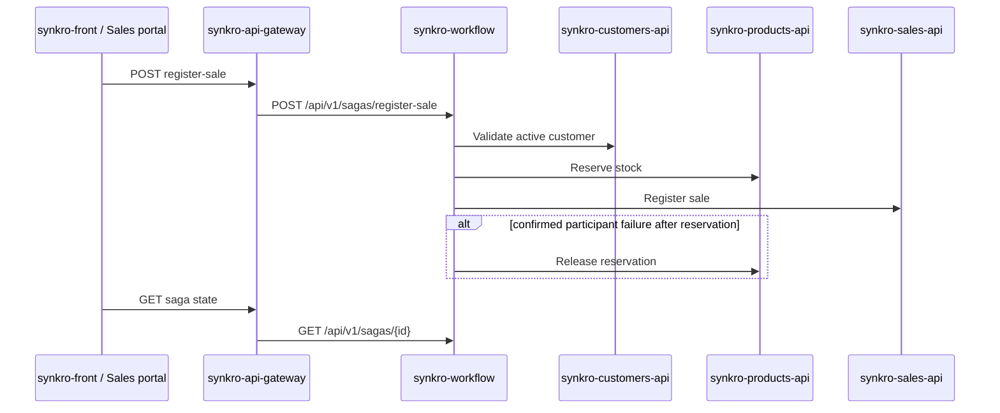

# synkro-workflow

> Durable sale-registration saga that validates the customer, reserves stock, persists the sale and compensates failed flows.

Part of the **SynkroTech SAS Sales Management System**. Architecture, decisions and
contracts live in [synkro-docs](https://github.com/code-corhuila/synkro-docs).

**Quick start:** prepare workflow_app and the workflow_schema migrations through infrastructure, then start the owning Docker service with its protected inputs. See [Getting started](#getting-started).

## What it does

- Coordinates Customers, Products and Sales through their published HTTP contracts.
- Stores each saga durably before external effects and exposes its public state.
- Uses step-specific idempotency and releases reservations when compensation is required.
- Applies bounded retries, full jitter, participant circuits and the delivered WFLK advisory-lock namespace.
- Owns workflow_schema migrations inside db/; infrastructure owns the database instance.

## Where it fits



The browser enters through the gateway. The saga's service identity performs participant calls; the human initiator remains the sale author. Recovery and coordinated lock-algorithm rollout are explicit operations.

## Tech stack

| Component | Choice |
|---|---|
| Language / framework | Java 21; Spring Boot 3.5.0 |
| Build | Maven: workflow-core, workflow-adapters, workflow-app |
| Persistence | PostgreSQL workflow_schema; Flyway tooling runner |
| Runtime | Internal HTTP 8080 and bounded background execution |

## Dependencies

| Depends on | Purpose | Configuration |
|---|---|---|
| PostgreSQL | Durable saga state | WORKFLOW_DATABASE_URL and protected workflow_app password |
| Customers / Products / Sales APIs | Saga participants | Internal platform addresses |
| Auth public key and SERVICE token | Validate human callers and authorize participant requests | JWT_PUBLIC_KEY_PATH; WORKFLOW_SERVICE_TOKEN |

## Getting started

Use **PowerShell or Bash** with the sibling workspace prepared. From `synkro-infra-postgres`, after PostgreSQL and workflow_app exist:

```text
python scripts/synkro.py migrate dev --mode postgres-migrations --domain workflow
```

From this repository root, the owning `deploy/compose.yml` supplies the service and migration runner. Populate its committed example inputs before startup; use root composition for the complete platform. A coordinated stop-all procedure is required when switching advisory-lock algorithms.

For the complete platform, start from [synkro-infra-postgres](https://github.com/code-corhuila/synkro-infra-postgres).

## Configuration

The committed [.env.example](.env.example) is the configuration inventory.
Its values are examples; required inputs and defaults follow its comments and the
owning implementation. Keep real secrets in protected local files.

| Variable | Purpose |
|---|---|
| `FLYWAY_URL` | Connection address, origin or build-time entry point |
| `FLYWAY_USER` | Connection or administrator identity |
| `FLYWAY_PASSWORD` | Credential supplied locally |
| `WORKFLOW_DATABASE_URL` | Connection address, origin or build-time entry point |
| `WORKFLOW_APP_PASSWORD_PATH` | Protected credential file path |
| `JWT_PUBLIC_KEY_PATH` | Identity key input; keep private material outside Git |
| `WORKFLOW_SERVICE_TOKEN` | Service identity or token lifetime; see the configuration comments |
| `PLATFORM_NETWORK` | Docker network selection |
| `WORKFLOW_EXECUTORS` | Workflow executors |
| `WORKFLOW_QUEUE` | Workflow queue |
| `WORKFLOW_RESPONSE_TIMEOUT_MS` | Workflow response timeout ms |

## Interface

| Method / route | Access / result |
|---|---|
| POST /api/v1/sagas/register-sale | ADMIN / SALESPERSON; Idempotency-Key; 201 or same-request 200 |
| GET /api/v1/sagas/{id} | Authorized human saga-state lookup |
| GET /health | Public; probes the durable saga store |

The request contains customerId and 1–100 product/quantity lines. Public states are RUNNING, COMPLETED, COMPENSATED and FAILED. The [Workflow contract](https://github.com/code-corhuila/synkro-docs/blob/main/07-api/contracts/openapi/synkro-workflow.yaml) defines exact semantics.

## Project structure

```text
workflow-core/       domain, use cases and ports
workflow-adapters/   HTTP/security, participant clients and JDBC
workflow-app/        composition and execution lifecycle
db/                  owning Flyway migrations and reversions
deploy/              service and migration runner
tests/               process and exact-pin real-participant checks
docs/                resilience design and rollout procedures
```

## Testing

```text
mvn -B verify
python tests/check_coverage.py
python -m unittest discover -s tests -p test_deployment.py
```

`tests/process_acceptance.py` uses a real disposable PostgreSQL/JVM with controlled HTTP participants. `tests/real_services_acceptance.py` additionally requires six exact participant pins. The old hybrid Customers-501 expectation is historical, not a current-provider acceptance check.

## Branching and contributing

Use a `feat/`, `fix/` or `chore/` child branch and a PR into `develop`.
Permanent branches are `develop`, `qa` and `main`; none accepts direct commits.
Promote through a `qa-<description>` or release child with `git cherry-pick -x`.
`main` requires approval from `ariel5253`. Use English Conventional Commits.
See [Git conventions](https://github.com/code-corhuila/synkro-docs/blob/main/00-governance/git-conventions.md).

## Further documentation

- [Saga operations](docs/saga-operations.md).
- [Resilience and rollout](docs/resilience-and-rollout.md).
- [Testing](docs/testing.md).
- [Domain rules](https://github.com/code-corhuila/synkro-docs/blob/main/02-domain/entities-and-rules.md), [contracts](https://github.com/code-corhuila/synkro-docs/tree/main/07-api/contracts/openapi) and [testing strategy](https://github.com/code-corhuila/synkro-docs/blob/main/11-quality/testing-strategy.md).

<!-- Preserve previously published README section links. -->
<a id="register-sale-workflow"></a>
<a id="workflow-resilience-correction-hu-wkf-04"></a>
<a id="validation"></a>
<a id="branching"></a>
